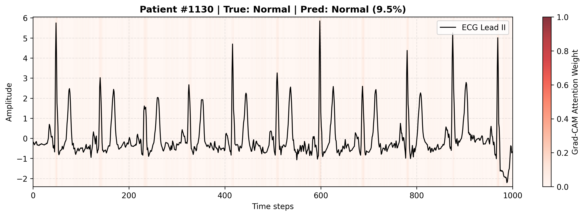
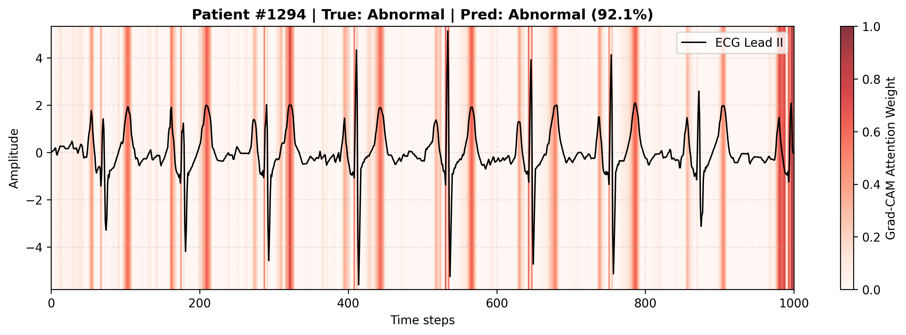

# ECG Anomaly Detection
This project uses a 1D ResNet model to detect ECG anomalies from 12-lead signals through binary and multi-label classification. 1D Grad-CAM is applied to highlight important waveform regions, improving model interpretability without requiring segment-level annotations.

## License
This project uses the PTB-XL dataset licensed under **[CC BY 4.0](https://physionet.org/content/ptb-xl/view-license/1.0.3/)**.

## Result
## Explainability with Grad-CAM

To understand model decision-making, Grad-CAM attention maps are applied to 1D ECG signals (Lead II). The visualizations highlight regions that most strongly influence the abnormality predictions:

| Normal Case (Patient #1130) | Abnormal Case (Patient #1294) |
| :---: | :---: |
|  |  |
| **True**: Normal \| **Pred**: Normal (9.5% Anomaly Score) | **True**: Abnormal \| **Pred**: Abnormal (92.1% Anomaly Score) |

### Key Observations
* **Normal Signal (Patient #1130):** The model assigns consistently low attention weights across the entire sequence (faint/near-zero highlights), indicating no salient morphological anomalies detected.
* **Abnormal Signal (Patient #1294):** Strong attention activation (dark red bands) directly aligns with key wave deformities and abnormal ventricular complexes, demonstrating that the model accurately grounds its predictions on clinically relevant heartbeat irregularities.

## Quick Start

To quickly evaluate and run the project via Google Colab / Google Drive:

1. **Access Google Drive Folder:**  
   Open the shared project folder: [Google Drive Folder](https://drive.google.com/drive/folders/1QWIWilde0ukbobXbNpy6tVNQ8lF_La_T?usp=drive_link).

2. **Add Shortcut to Drive:**  
   Click on the folder dropdown or right-click the folder, then select **"Add shortcut to Drive"** (place it in **My Drive** for seamless path mounting in Google Colab).

3. **Execute the Code:**  
   Navigate to the `src/` directory and open the desired notebook/script to run the experiments.